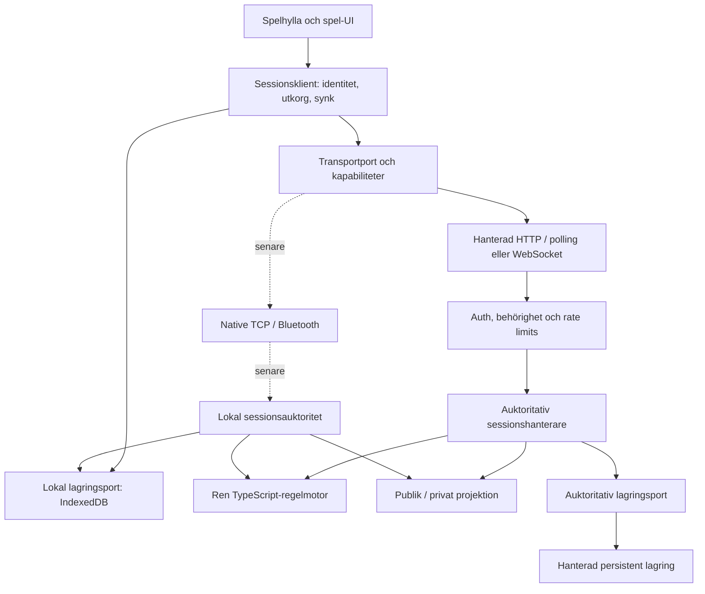
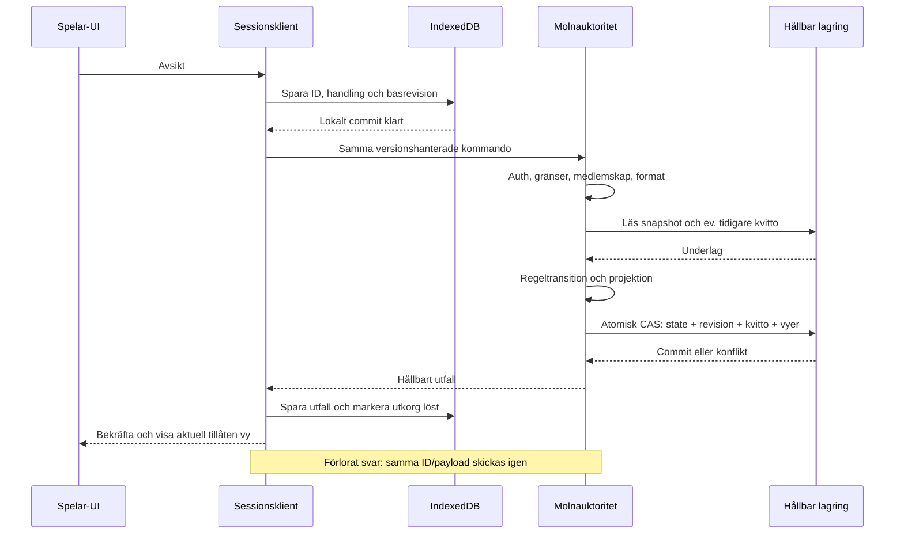
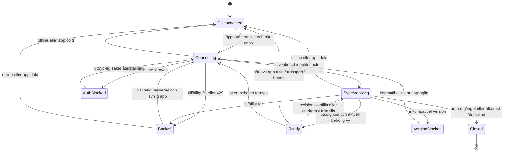
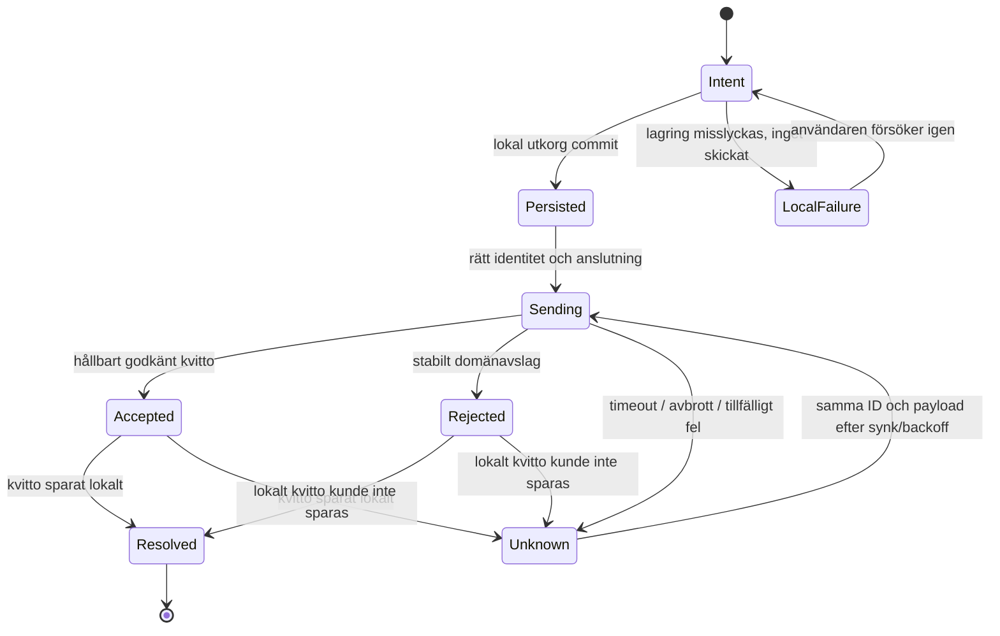
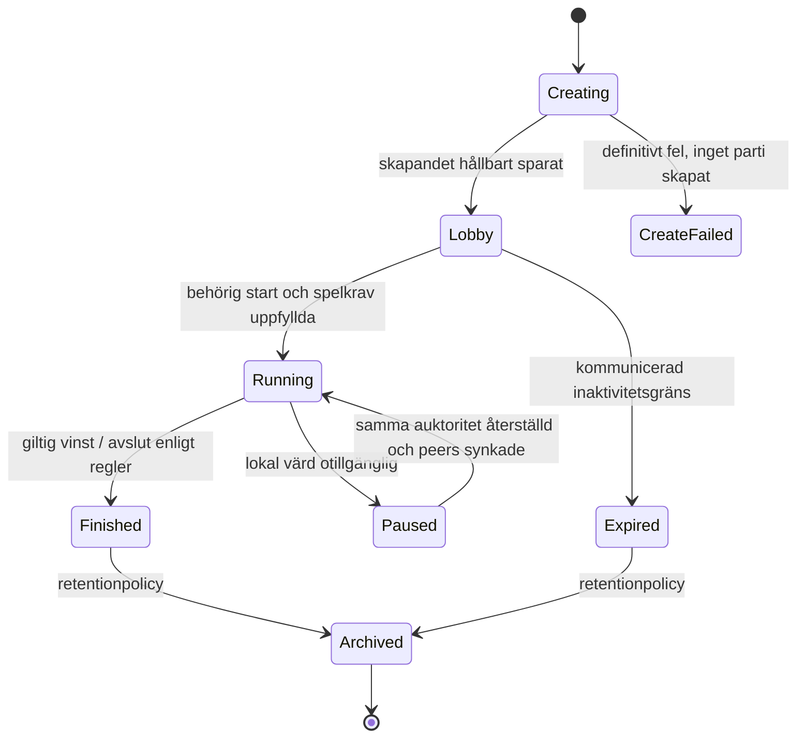

# Spelhyllan / OpenCatan — High-Level Design

Version 1.0 · 2026-11-01 · Föreslagen måldesign för E1/E2; ej implementerad helhet.
Kravbas: [PRD 3.0](../PRD.md). Ändrar inte produktkraven. Befintlig PWA 1.2.0 och OpenCatan-preview är två olika implementationer; de förenas stegvis.

## 1. Designbeslut och gränser

| Beslut | Innebörd / krav |
|---|---|
| D-01: en regelimplementation | Ren TypeScript-motor med tillförd tid/slump, utan UI/nätverk/lagring. UI får visa tillåtna val men auktoriteten validerar. ARC-01, UX-08. |
| D-02: auktoritativ session | Molnauktoritet för internetspel; lokal auktoritet för offline/pass-and-play och senare LAN/native. Auktoriteten håller full intern state. Ingen automatisk värdöverföring. DATA-02, SEC-06. |
| D-03: hållbar commit före godkännande | Intern state, revision, kvitto och materialiserade spelarvyer skrivs atomiskt. Nätverket får leverera flera gånger; domänändringen genomförs högst en gång per accepterat ID. DATA-01/02. |
| D-04: separata livscykler | Anslutning, kommando och parti har egna tillstånd. ”Ansluten” betyder inte ”synkroniserad” och timeout betyder inte avvisat. UX-04/05, NFR-01. |
| D-05: utbytbara adaptrar | Transport och lagring bakom explicita kontrakt. Behåll befintlig PartyKit-preview och Lovable-prototyp medan ett flöde i taget flyttas. ARC-02, DATA-04. |
| D-06: leverantörsval via litet experiment | Lovable Cloud behålls för fungerande tre-i-rad. Före Catan väljs en hanterad miljö som kan köra samma TypeScript-motor och klara atomisk persistens. Ingen migration beslutas enbart av detta dokument. OPS-01. |

Spelare, molnoperatör och lokal värd har olika tillit. En betrodd värd kan läsa alla interna kort; denna design skyddar klienterna från att få andras kort men ger inte kryptografiskt skydd mot värden. En fysisk enhet med två spelare kan inte garantera hemliga händer mot den som kontrollerar enheten. Offline-Catan med privata händer behöver därför flera enheter eller en uttryckligen accepterad pass-and-play-modell. Tre-i-rad har inga hemliga händer.

## 2. Komponenter och beroenden



Pilar visar anrop/beroenden. UI importerar sessionsklientens publika typer, inte leverantörsklient eller intern auktoritetsstate. Auktoriteten anropar regelmotorn och injicerade lagrings-/slumptjänster; motorn importerar inte dessa tjänster. UI-koppling till Redux kan behållas via en adapter under övergången. En HTTP-endpoint är en adapter till sessionen, inte själva regelmotorn.

| Komponent | Ansvar | Får inte göra |
|---|---|---|
| Spel-UI | Rita mottagarens vy, samla avsikt, visa pending/fel och touchflöden. | Skapa slutliga tärningsutfall eller ändra auktoritativ state. |
| Regelmotor | `validate/transition(state, actor, action, context)`, regelinvarianter och domänhändelser. | I/O, leverantörsanrop, egen väggklocka/slumpkälla. |
| Sessionsklient | Spara intent, omsända samma kommando, hantera revisioner/identitet/återanslutning. | Tolka timeout som avvisat eller byta identitet tyst. |
| Sessionsauktoritet | Behörighet, dedup, tur-/fasvalidering via motor, revision och atomisk commit. | Bekräfta hållbar framgång innan commit. |
| Projektion | Skapa tillåtna spelarvyer och logghändelser med fältlistor. | Serialisera full state och sedan hoppas att UI döljer fält. |
| Transport | Leverera bytes/envelopes, status och verkliga begränsningar. | Ha spelregler eller lova exakt-en-gång-leverans. |
| Lagring | Transaktioner, schema, snapshots/kvitton, utkorg och retention. | Bestämma ett drags giltighet. |

Föreslagna paketgränser är logiska, inte krav på omedelbart monorepo: `domain/`, `session/`, `ports/`, `adapters/`, `ui/`. `src/game/engine/base` och `src/session` är startpunkter, men de befintliga state-typerna behöver frigöras från Redux och setup-logiken extraheras. Importgränser ska gå att kontrollera automatiskt.

## 3. Identiteter och datamodell

Identiteter hålls isär: `principalId` (verifierat molnsubjekt eller lokalt parat subjekt), `playerId` (plats i session), `sessionId` (parti), `roomId` (inbjudnings-/lobbyresurs). Mappningen till spelarplats ägs av auktoriteten. En ny inloggning är inte automatiskt samma spelare.

| Objekt | Innehåll / ägare |
|---|---|
| SessionMetadata | Speltyp, regelversion, deltagare/platser, inställningar, livscykel, auktoritets-ID och fast auktoritetsepok. Ingen hemlig hand. |
| AuthoritySnapshot | Schema-/regelversion, session, revision, full intern state, fas, kortlek, intern slump-/effektinformation och senaste hållbara commit. Endast auktoritet/behörig återställning. |
| PlayerView | Protokoll-/vyversion, session, auktoritetsepok, revision, publika fält och denna spelares privata fält. Aldrig källa till full återställning. |
| CommandIntent | Klientens stabila ID, session, protokollversion, förväntad revision, handling och lokalt pendingstatus. Sparas innan sändning. |
| CommandReceipt | Nyckel `(sessionId, playerId, commandId)`, kanonisk payloadhash, utfall/felkod, beslutsrevision och regel-/protokollversion. Inget fullständigt snapshot eller andras hemligheter. |
| IdentityBinding | Verifierat subjekt till spelarplats, giltighet och eventuell framtida återställningsmekanism. Token är inte ett publikt playerId. |

Håll isär protokollversion, sparschemaversion, regelversion och app/build-version. Okänd version ger ett maskinläsbart fel och bevarade data. Ett pågående parti är låst till sin regelversion; ny app får inte tyst ändra reglerna mitt i partiet.

Slump genereras av auktoritetens injicerade CSPRNG och används som explicit input till motorn. Utfall och nödvändig intern fortsättningsinformation sparas i samma commit som draget. Ingen klient får full framtida kortordning, slumpseed eller annan spelares privata återställningsdata. Vid misslyckad CAS är draget inte accepterat; vid lyckad commit avgör kvittot alltid återförsökets resultat.

## 4. Protokoll och transportport

Logiskt kontrakt, inte en ny parallell implementation i denna dokumentetapp:

```typescript
interface CommandEnvelope {
  protocolVersion: number;
  sessionId: string;
  authorityEpoch: number;
  commandId: string;
  expectedRevision: number;
  action: { type: string; payload: unknown };
}
// actor kommer från verifierad anslutning/token, inte från envelope.
interface TransportCapabilities {
  requiresInternet: boolean;
  updateMode: 'polling' | 'push';
  ordering: 'none' | 'perConnection';
  delivery: 'bestEffort' | 'connectedOnly';
  targetedDelivery: boolean;
  maxPayloadBytes: number;
  discovery: 'invitation' | 'local' | 'none';
  backgroundProgress: false;
}
```

Operationer: `connect(credentials, invitation?)`, `submit(command)`, `readView(sessionId, knownRevision?)`, `readReceipt(commandId)`, `subscribe(handler)` och `close()`. HTTP kan implementera prenumeration genom foreground-polling; native kan implementera riktad push. Sessionsklienten äger retry, utkorg och synkronisering. Maxpayload och versionsstöd kontrolleras på båda sidor; autentisering och begränsningar kontrolleras alltid på serversidan.

Svar har version, session, auktoritetsepok, commandId där relevant, utfall, maskinläsbar felkod, revision och vid behov tillåten vy eller retry-tid. En mottagare avvisar fel session/epok och ignorerar äldre vyer. Fullständiga vyer kan hoppa fram i revision; framtida deltauppdateringar kräver exakt basrevision, annars full synk. Löpnummer är sessionsrevisioner, inte transportens paketnummer.

Payloadhash binds till kanoniskt innehåll inklusive handling, version, epok och förväntad revision; byte-/fältordning får inte ändra betydelsen. Samma nyckel och annat innehåll ger `COMMAND_ID_CONFLICT`. Dedup sker innan jämförelse med aktuell revision, så ett tidigare godkänt kommando inte blir avvisat vid omsändning.

Kvitto-retention ska täcka hela perioden då sessionen kan återupptas plus retryfönster. Efter gallring lämnas en utgångsmarkör eller stängd session som nekar gamla kommandon; saknat kvitto får inte göra att ett gammalt accepterat ID exekveras på nytt. Exakta tider är en releasefråga (§11).

## 5. Kommandoflöde och atomisk lagring



En betrodd commit-operation gör medlems-/versionskontroller och dedup igen inom transaktionen, kontrollerar basrevision och skriver allt eller inget. Unik kvittonyckel och CAS/serialisering förhindrar samtidiga dubbeldrag. En regelavvisning ger också ett stabilt beslutsutfall som kan återfås; tillfälliga auth-, överlast- och transportfel är inte domänbeslut och finaliserar inte kommandot. Vid revisionskonflikt väljer användaren eventuellt ett nytt drag med nytt ID efter synk.

Om commit lyckas men publicering av en notifiering misslyckas finns state/vyer redan kvar. Polling eller återanslutning hittar dem. Framtida push använder transaktionell notifieringsutkorg eller motsvarande för att undvika glapp, men notifieringen är aldrig hållbarhetskvittot.

Lokal auktoritet använder samma sessionsalgoritm och en IndexedDB-transaktion över intern state, revision, kvitton och vyer. Motorn beräknar först; transaktionen jämför läst basrevision och skriver atomiskt. Undvik godtycklig async-I/O mitt i en IndexedDB-transaktion. Klientens utkorg och auktoritetens kvitton har olika syften, även om de råkar ligga på samma enhet.

### Hanterad TypeScript-exekvering — experiment före leverantörsbeslut

Första kandidat: en serverfunktion i Lovable Cloud/Supabase som kör den gemensamma motorn, med en privilegierad, atomisk databasoperation för **persistens**, inte duplicerade spelregler. Serverfunktionen hämtar full intern state på serversidan och CAS-committar resultat, kvitto och spelarvyer tillsammans. Klienter får inte anropa intern commit, skriva state eller läsa hemliga tabeller. Om funktions-/databasbehörigheter, transaktioner, versionering eller kostnad inte fungerar väljs en annan hanterad adapter.

Andra kandidat: TypeScript i Cloudflare Workers/PartyServer med Durable Objects, där ett objekt samordnar ett parti och persistent lagring ligger bakom samma port. Att en instans är i minnet ersätter inte krav på hållbar commit eller korrekt samtidighet. Ny produktion ska inte förutsätta den gamla PartyKit-hostingplattformen; dokumentationen om driftsättning måste verifieras vid val.

**Beslutspunkt ADR-01:** demonstrera tre-i-rad med exakt samma motor online och lokalt, samtidighet, commit/krasch/retry, privat dummydata och mätta kostnader. Välj därefter. Befintlig SQL-auktoritet för tre-i-rad fortsätter tills ersättaren klarat dessa tester. Ingen av kandidaterna är verifierad med OpenCatan i detta skede.

## 6. Tillståndsdiagram

Diagrammen är målspecifikation. Övergångar nedan anger viktiga villkor/sidoeffekter; verkliga implementationer behöver explicit reducer/state machine och tester, inte bara diagram.

### 6.1 Anslutning per deltagare



- Bara `Ready` tillåter nytt spelkommando; anslutnings-/versionsblockering raderar aldrig utkorgen.
- Vid återkomst verifieras identitet, kvarvarande intent avgörs, sedan hämtas aktuell vy. Ett äldre kvitto får inte rulla tillbaka en nyare vy.
- `Disconnected` beskriver klientens uppdateringsläge; molnpartiet kan fortsätta för andra deltagare. Dold app pausar polling. In-flight-anrop kan hinna committa; kvarvarande utkorg gör utfallet återhämtningsbart.
- Tillfällig tokenförnyelse kan gå via `Connecting`; ett oåterställbart fel går till `AuthBlocked`. Ingen automatisk signup för att ersätta förlorad identitet.

### 6.2 Ett kommando



`Persisted`/`Unknown` överlever processdöd via utkorgen; efter omstart behandlas även ”skickas” som okänt. Återförsök använder exakt sparat innehåll. Ett avvisat drag ändras inte och skickas inte som ett nytt drag automatiskt. Ny användaravsikt skapar nytt ID. Ett versions-/authfel blockerar sändningen men är inte ett bevis för att en tidigare sändning aldrig committade.

### 6.3 Partiets livscykel



Okänt skapandeutfall stannar under utredning/omsändning i kommandodiagrammet; det får inte skapa ett nytt parti med nytt ID. Molnets processomstart återställer samma `Running`-parti från lagring; en frånkopplad klient pausar inte automatiskt andra. Ingen automatisk övergång från pågående parti till raderat på grund av en enskild spelares frånvaro. Explicit övergivande/radering och retentionpolicy måste beslutas innan de automatiseras.

Spelmotorn har dessutom egna faser: Catan startplacering → roll → eventuell discard/rövare/stöld → huvudfas → nästa tur/slut. Utvecklingskort kan skapa underfaser, exempelvis pre-roll riddare som återgår till roll. Detaljerad regel-state-chart tas fram när setup extraheras och omfattar alla kommandon; befintlig `GamePhase` får inte ensam betraktas som verifierad specifikation.

## 7. Felmodell och användarbeteende

| Kodklass | Återförsök / övergång | UI och datakonsekvens |
|---|---|---|
| `NETWORK_UNAVAILABLE`, `TIMEOUT`, tillfällig `SERVER_UNAVAILABLE` | `Unknown`/`Backoff`; samma ID | Visa ”utfallet kontrolleras”; behåll intent. Ingen optimistisk hållbar bekräftelse. |
| `RATE_LIMITED` | Respektera `Retry-After` och jitter | Behåll intent, visa väntetid, stoppa aggressiv polling. |
| `AUTH_EXPIRED` | En samordnad tokenförnyelse | Behåll plats/utkorg; återuppta samma intent när verifierat. |
| `IDENTITY_UNRECOVERABLE`, `FORBIDDEN` | Blockera; ingen ändlös retry | Förklara åtkomstproblemet; erbjud kontrollerad återställning eller nytt separat parti. |
| `REVISION_CONFLICT` | Stabilt avslag, sedan synk | Visa aktuell vy; nytt drag kräver användarval och nytt ID. |
| `ILLEGAL_ACTION`, `ROOM_FULL` | Stabilt avslag | Begriplig orsak utan privat information. |
| `COMMAND_ID_CONFLICT` | Blockera det felaktiga intentet | Behåll diagnostik utan hemlig payload; exekvera inte annat innehåll. |
| `LOCAL_STORAGE_FAILURE` | Stoppa ny sändning / behåll osäker utkorg | Visa att draget inte skickats, eller att redan sänt utfall behöver kontrolleras. Skilj dessa fall. |
| `AUTHORITY_STORAGE_FAILURE` | Ingen framgång före commit | Transient retry med samma ID; efter osäker commit avgör kvittouppslag. |
| `UNSUPPORTED_VERSION`, `CORRUPT_SAVE` | Blockera berörd session | Bevara originaldata, erbjud kompatibel version eller säker återställning. |
| `SESSION_EXPIRED`, `SESSION_DELETED` | Slutligt `Closed` | Ingen omsändning eller ny session under gammalt ID. Förklara att återställning saknas. |

Retry-policy inför E1: exponentiell väntan med jitter och begränsad samtidighet, max en sändning per sessionsklient, inga retry-loopar i bakgrunden. Numeriska intervall/rate limits är konfiguration och mäts före release; prototypens fasta femsekunderspolling och generiska felhantering uppfyller ännu inte hela policyn. Transportfel och HTTP-status översätts till stabila domänneutrala koder; inga råa databastexter eller tokens till UI/logg.

## 8. Säkerhetsdesign och hotmodell

| Hot / tillitsgräns | Kontroll | Verifiering |
|---|---|---|
| Klient förfalskar playerId, drag eller framtida revision | Verifierat subjekt, serversidig platsbindning och regelvalidering, CAS. | T-03/04/07. |
| Länk läcker / obehörig läser rum eller prenumeration | Inbjudan används bara för kontrollerad join; medlemskontroll på API och varje vy/prenumeration. Fullt rum skyddar platser. Framtida länkutgång/rotation ingår i ADR-02. | T-03/06. |
| Replay/dubbelkommando/ändrad payload | Unikt ID, innehållshash, stabilt kvitto och definierad retention/utgång. | T-04/10. |
| Andras händer läcker i state, fel, logg eller realtid | Full intern state i server-only storage; fältbaserad projektion till separata mottagarvyer. Inga hemliga fält i publika notifieringar. | T-06 med faktisk nätverksinspektion. |
| Skriptinjektion stjäl token från webblagring | Text-rendering, inga osäkra HTML-insättningar, CSP, inga externa runtime-script, beroendegranskning; tokens får inte loggas/exporteras. IndexedDB eliminerar inte XSS-risken. Native credentials senare i säker plattformslagring. | T-08 + säkerhetsgranskning. |
| Masskapande, gissning, stor payload, reconnectstorm | Gateway- och sessionsgränser före dyrt arbete, IP/identitet/rum-kvoter, payloadtak, backoff och kostnadslarm. | T-08 i isolerad testmiljö. |
| Felkonfigurerad databas / klient kringgår API | RLS för läsningar, neka klientmutation, intern commit server-only med minsta möjliga rätt. Testa också direkt databas/API/prenumeration. | T-06/08. |
| Illvillig lokal värd / molnoperatör | Betrodd auktoritet dokumenteras. Ingen utfästelse om skydd mot dess fulla interna åtkomst. Ingen automatisk värdöverföring. | Granskning + T-10. |

Rums-ID:n ska vara svåra att gissa; användarvänliga kortkoder kräver separat gränssatt uppslag, inte svagare läsbehörighet. Prototype-UUID är inte ett löfte om färdiga join-abuse-kontroller. Publika klientnycklar är tillåtna; privilegierade nycklar stannar i serverns secrets och roteras enligt driftrutin.

Rate limits behöver separata kategorier: anonym signup, create, join, read/poll, submit, subscriptions och payload. Leverantörens standardgränser räcker inte som produktpolicy. Återförsök och dedup kostar fortfarande resurser och ska också begränsas. Normala spelare bakom samma NAT ska verifieras; använd inte enbart IP som identitet. Före pilot beslutas konkreta siffror, svarskoder/Retry-After, hårda kvoter och kostnadslarm i ADR-03. Larm får inte beskrivas som garanterat kostnadstak.

## 9. Offline, uppdateringar och återställning

Service worker cachelagrar appskal och nödvändiga resurser per build. ”Klart för offline” kräver verifierad komplett nedladdning. Installation av ny build får inte förstöra den aktiva; aktivering väntar på pågående lokala skrivningar och lämnar utkorgen hållbart sparad. Användaren får ett kontrollerat uppdateringsval.

Lokalt spel: IndexedDB-adapter med versionshanterad state/kvitto/utkorg, transaktionell CAS och hantering av kvot/nekad beständighet. Molnspel: klientcache är bara behörig vy, aldrig auktoritativ ersättning. Utan nät kan UI visa senast sparad tillåten vy som inaktuell men inga nya internetdrag godkännas. Prototypen återhämtar för närvarande vyn först när nätet kommer tillbaka.

Webblagring kan rensas trots beständighetsbegäran; en lokal säkerhetskopia har därför ett eget format. Full auktoritetsbackup innehåller hemligheter och får inte exporteras som vanlig spelarkopia. En molnspelare får bara exportera godkänd publik/egen information enligt beslutad policy. Att dela en full lokal värdbackup kan röja allas kort och måste varnas/behörighetsstyras.

Separata felmodeller:

- Klient-/auktoritetsprocess dör: återställ senast committade snapshot och kvitton; ett hållbart bekräftat drag ska inte förloras vid vanlig processomstart.
- Lokal värdenhet eller webblagring försvinner: kräver behörig backup eller partiet kan vara förlorat. Andras beskurna vyer räcker inte.
- Leverantörens lagring förloras: backup/PITR och testad restore behövs; RPO/RTO fastställs separat. En säker transport eller DB-transaktion ger inte automatiskt katastrofåterställning.
- Inkompatibel uppdatering: bevara data/regelversion och stöd gammal session eller stoppa säkert. Rulla inte tillbaka databasformat med enbart frontend-rollback.

## 10. Drift och observerbarhet

Statisk PWA kan ligga kvar på GitHub Pages; backend körs hanterat. Separera test och produktion, använd versionsstyrda migrationer och verifiera gamla installerade klienter mot ny backend. Driftsättning av app och backend ska inte kräva samtidig uppdatering av alla iPads.

Mät p50/p95 kvittotid från användaravsikt till hållbart kvitto, motspelarens synlighetstid, andel återanslutningar/synkfel, kvitto-retries, avvisningskoder, auth-/rate-/lagringsfel och kostnad per aktivt rum/speltimme. Nätlatens och lokal skrivtid redovisas för PRD-målen. Korrelations-ID:n är begränsade; logga aldrig token, kortpayload eller intern snapshot. Retention gäller också loggar och backups.

Ingen stor lasttestning mot fungerande produktion. Använd isolerad miljö och budget för T-08. Innan bredare pilot beslutas gallring av gamla rum/anonyma identiteter, avslutade partier, kvitton och lokala kopior. Samordna radering med aktivt parti och retrykontrakt; kommunicera när åtkomst upphör. Definiera driftansvar, incident-/rollbackrutin och leverantörsavbrottens användarbesked.

## 11. Gap, beslut och liten implementationsordning

### Nuläge kontra mål

| Finns | Gap till denna HLD |
|---|---|
| PWA med hashverifierad cache och manuellt aktiverad uppdatering; lokalt tre-i-rad i IndexedDB. | Gemensamma sessionskontrakt, sparformat och migrering för fler spel. |
| PWA-onlineadapter med anonym auth, localStorage-utkorg och foreground-polling. | Gemensamma fel-/state machines, IndexedDB-utkorg, Retry-After/jitter, strängare formatskydd och säkra identitetsförlustflöden. |
| Lovable tre-i-rad via validerande SQL-RPC, beständig state och dedup. | Samma motor online/lokalt, payloadbindning/stabila avslag, definierad kvitto-retention och testad serverkraschåterställning. |
| OpenCatan `src/session` och PartyKit-adapter; delar av motorn extraherade. | Fristående state-typer/setup, full snapshot, durable receipts, komplett privata vyer, spelarhandel och naturliga fulla partier. |
| Ursprunglig kod/tillgångar och omfattande äldre PRD. | Klarlagd licens/rättigheter; behörig distribution, kvalitetsskuld och expansionsspecifikationer. |

### Öppna beslut före respektive releasegrind

| Beslut | Underlag / grind |
|---|---|
| ADR-01 exekveringsmiljö | Samma TS-motor, atomisk commit, concurrency/crash och kostnad i referensspelet. Före att OpenCatan flyttas online. |
| ADR-02 identitet/inbjudan | Förlorat token, Safari/PWA-isolering, platsåterställning utan kortläcka, länkutgång. Före E1-pilot. |
| ADR-03 driftgränser | Konkreta kvoter/payloadgränser, budgets, retention, dedupfönster, backup/RPO/RTO och ansvar. Före E1-pilot. |
| ADR-04 regelreferens/rättigheter | Avgränsade grundregler, varianter, licensbelägg och tillgångsersättningar. Före E2-distribution. |

### Genomför i små steg

1. Definiera/implementera gemensamma kontrakt och rena tillståndsövergångar i tre-i-rad, utan leverantörsbyte. Lägg till versionsfel, stabila felkoder och payloadbindning. T-03/04/09.
2. Flytta onlineutkorg till lagringsport/IndexedDB och testa krasch före/efter commit samt auth-/lagringsfel. Behåll fungerande lokal sparning och kontrollera uppdateringskompatibilitet. T-01/02/04.
3. Kör ADR-01-experimentet med samma motor lokalt och i en hanterad auktoritet. Testa privat dummydata innan riktiga kort. Välj leverantör utifrån körda tester, inte dokumentationsantaganden. T-04/06/08.
4. Färdigställ ADR-02/03 och nödvändiga begränsningar/observerbarhet. Verifiera vila, två fysiska nätverk och kompatibla uppdateringar. Stäng E1-grinden.
5. Flytta OpenCatan setup och state, därefter ett grundspelsflöde i taget till sessionen. Implementera spelarhandel och auditerade projektioner. Naturliga 3-/4-spelarpartier och rättighetsgranskning stänger E2.
6. Capacitor/LAN och sedan Bluetooth är separata experiment i E3; samma protokoll/auktoritet/lagringskrav återanvänds. Ingen automatisk värdöverföring införs som bieffekt.

Varje steg ska kunna granskas, testas och släppas utan stor omskrivning. Krav och testfall i [PRD §8](../PRD.md#8-verifieringsplan-och-releasegrindar) är spårbarhetsmatris; aktuell exekveringsstatus redovisas i respektive verifieringsrapport. Detta dokument beskriver design och gap, inte nya passerade tester.
